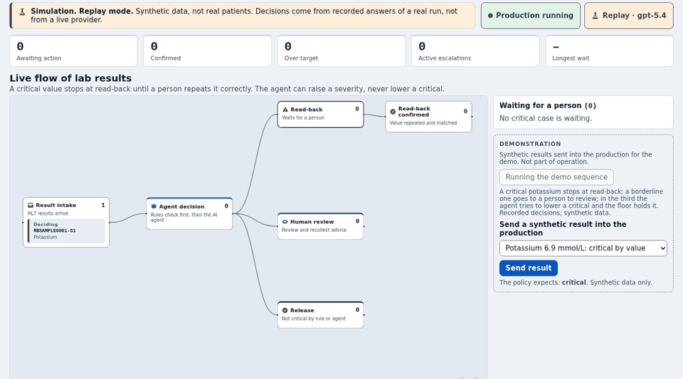

# iris-readback

An InterSystems AI Hub agent triages lab results inside an IRIS Interoperability production. It can raise a result to critical but never lower one the rules call critical, and nobody is notified of a critical result until a person has done the read-back by repeating the value. The rules guarantee the safety, the agent explains, and I measured what would happen if the agent decided alone.



[3:41 video](https://youtu.be/ML2pBgBkqUo) · [Live demo](http://109.123.244.170/)

## For judges: two minutes

1. Open the [live demo](http://109.123.244.170/) and press **Run demo sequence**. A critical stops at read-back, a borderline one goes to a person, and the agent tries to lower a critical and the floor holds it.
2. Open the **Decisions** tab. Floor, agent and final decision sit side by side. Open the row with the "held" seal to see the rule, the four tool calls and the evidence check.
3. Sign in as `communicator1` with the password `hVWrjsSnttT8AYIn9acJ` (accounts and roles: [Demo](DETAILS.md#demo)). Open the read-back task from the card at the read-back station of the flow, type a wrong value (refused), then the right one (it closes the task and the alert).
4. The measured evaluation is in [What I measured](#what-i-measured), and the full figures are in [DETAILS.md](DETAILS.md#evaluation).
5. To run it yourself, use the five commands of [Run it](#run-it). It takes about two minutes from clone to panel.

## Run it

```
docker load -i irishealth-community-2026.3.0AI.154.0-docker.tar.gz   # then docker tag, if the name differs
cp .env.example .env   # set READBACK_DEMO_PASSWORD; leave OPENAI_API_KEY empty for replay
src/ops/preflight.sh
docker compose up -d --build
src/ops/verify.sh
```

Measured: from clone to a working panel in 2 minutes on a clean machine, with the image already loaded. The last run took 77 s: build 56 s with no cache, start 15 s, verification 1 s.

The image rename and the provider key are in [Required by the organizers](#required-by-the-organizers). More ways to run it: [REPRODUCE.md](REPRODUCE.md).

## What I measured

I ran the whole product over 240 synthetic cases for `gpt-5.4` and `gpt-5.4-mini` and compared its route with the expected one. No result that the rules call critical was silenced, for either model. Two contextual criticals go to a person, not to read-back.

The safety comes from the deterministic layers. Without the rule's verdict, the agent sends some contextual criticals to a person instead of read-back (14 with `gpt-5.4`, 23 with `gpt-5.4-mini`), and `gpt-5.4-mini` creates 7 false criticals. So it never decides alone. It adds a justification a person can check. One author wrote the expected decisions, and I set the delta limits knowing the generator, so they are not calibrated.

| Arrangement | Model | Contextual criticals: read-back / sent to a person / released | Rule-critical silenced | False criticals |
|---|---|---|---|---|
| Range rule only | none | 0 / 0 / 60 | 0 | 0 |
| Range rule, change rule and release guard, no agent | none | 58 / 2 / 0 | 0 | 0 |
| Agent without the verdict | gpt-5.4-mini | 37 / 23 / 0 | 0 | 7 |
| Agent without the verdict | gpt-5.4 | 46 / 14 / 0 | 0 | 0 |
| Full product | both | 58 / 2 / 0 | 0 | 0 |

Matrices, cost and latency are in [DETAILS.md](DETAILS.md#evaluation).

## How it works

- **Rules first.** Critical limits and the change against earlier results set a floor. A critical by rule stays critical.
- **The agent investigates.** It calls four read-only tools, answers in a strict JSON schema and can only raise the severity.
- **The release guard.** A result is released only when the floor is zero, the sample is good and the value is not near a limit.
- **A person closes the loop.** A critical becomes a Workflow task. Only a matching value closes it. If nobody confirms, the alert escalates.
- **Every tool call is a Visual Trace step.** The `Readback.Agent.ToolTrace` operation records it, labelled `replay` in replay mode. Tracing never changes a decision.
- **Replay mode.** The flow runs from recordings, with no key. The demo runs this way.
- **Read-only MCP server.** Four tools read decisions and the evaluation. None confirms a read-back.

The architecture and the MCP setup are in [DETAILS.md](DETAILS.md#what-the-production-contains).

## Technology bonuses

| Bonus | Where it is used | File |
|---|---|---|
| PEX (Production Extension) | Unit conversion with the UCUM library, in Java, before the rules run | `java/src/com/readback/units/UnitsOperation.java` |
| Workflow Engine | The read-back and the human review are Workflow tasks | `src/Readback/Workflow/ReadbackTask.cls` |
| Custom outbound adapter | The delivery-and-receipt channel of the alert | `src/Readback/Notify/Pager.cls` |
| Embedded Python | The demo's HL7 messages come from methods with `[ Language = python ]`, called by `src/Readback/API/Flow.cls` | `src/Readback/Demo/Generator.cls` |
| Vector Search | Policy passages and similar confirmed cases | `src/Readback/Retrieval/Engine.cls` |
| Docker | The image build and the compose stack | `Dockerfile` |
| IPM | The package `iris-readback`, in the community registry | `module.xml` |
| MCP server | A read-only `%AI.MCP.Service` with four tools | `src/Readback/MCP/Service.cls` |
| Find a bug in AI Hub | Two bugs: [issue 18](https://github.com/intersystems-community/ai-hub-eap-bugreports/issues/18), the agent loop has no default bound, and [issue 19](https://github.com/intersystems-community/ai-hub-eap-bugreports/issues/19), the embedding model is described as bundled and is downloaded. Four more reports: [DETAILS.md](DETAILS.md#feedback-on-ai-hub-eap) | `DETAILS.md` |
| First article on Developer Community | https://community.intersystems.com/post/ai-agent-can-raise-critical-lab-result-never-lower-it | `README.md` |
| Second article on Developer Community | https://community.intersystems.com/post/safety-deterministic-agent-explains-ablation-ai-hub-agent-critical-lab-results | `README.md` |
| Video on YouTube | https://youtu.be/ML2pBgBkqUo | `README.md` |
| Online demo | http://109.123.244.170/ in replay mode, behind a proxy | `src/ops/proxy/nginx.conf.template` |
| Implement Community Idea (DPI-I-689) | Traceability of an LLM pipeline: every decision, tool call and human step is recorded | `src/Readback/Trace/Decision.cls` |

## Links

- Video, the main demonstration: https://youtu.be/ML2pBgBkqUo
- Live demo (replay mode, reset every hour): http://109.123.244.170/
- Repository: https://github.com/kcedd34/iris-readback
- IPM package: `zpm "install iris-readback"`
- Open Exchange: https://openexchange.intersystems.com/package/Readback
- First article on Developer Community: https://community.intersystems.com/post/ai-agent-can-raise-critical-lab-result-never-lower-it
- Second article on Developer Community: https://community.intersystems.com/post/safety-deterministic-agent-explains-ablation-ai-hub-agent-critical-lab-results
- Community Opportunity idea: https://ideas.intersystems.com/ideas/DPI-I-689
- My reports on AI Hub: [41](https://github.com/intersystems-community/ai-hub-eap/issues/41), [42](https://github.com/intersystems-community/ai-hub-eap/issues/42), [43](https://github.com/intersystems-community/ai-hub-eap/issues/43), [44](https://github.com/intersystems-community/ai-hub-eap/issues/44), [46](https://github.com/intersystems-community/ai-hub-eap/issues/46), [47](https://github.com/intersystems-community/ai-hub-eap/issues/47), and in the bug tracker [18](https://github.com/intersystems-community/ai-hub-eap-bugreports/issues/18) and [19](https://github.com/intersystems-community/ai-hub-eap-bugreports/issues/19)
- Everything left out of this README: [DETAILS.md](DETAILS.md)
- Battery, evaluation and ablation: [REPRODUCE.md](REPRODUCE.md)

## Required by the organizers

### Early Access image and build

It runs on the InterSystems IRIS for Health Community image with the AI Hub, Early Access. I tested two builds: **build 154**, tagged `irishealth-community:2026.3.0AI.154.0` (the default), and **build 109**, tagged `irishealth-community:2027.1.0AI.109.0`. The image comes from the Early Access portal. I do not redistribute it. The battery of 33 steps (`tests/e2e/triage_check.sh`) passes on build 154 and on build 109, each in its own stack, and the evaluation in replay gives the shipped report on both. One difference matters: [DETAILS.md](DETAILS.md#found-when-moving-to-build-109).

### Load and rename the image

The portal archive is named like the one below, or `...109.0...` for build 109:

```
docker load -i irishealth-community-2026.3.0AI.154.0-docker.tar.gz
docker images | grep irishealth
docker tag <name-printed-by-docker-load>:<tag> irishealth-community:2026.3.0AI.154.0
src/ops/preflight.sh
```

For build 109, tag the 109 archive as `irishealth-community:2027.1.0AI.109.0` and choose it in `.env`:

```
docker tag <name-printed-by-docker-load>:<tag> irishealth-community:2027.1.0AI.109.0
echo 'READBACK_BASE_IMAGE=irishealth-community:2027.1.0AI.109.0' >> .env
src/ops/preflight.sh
```

The `docker tag` line is needed only when the loaded image has another name. `src/ops/preflight.sh` checks the tag and prints the steps if it is missing.

### LLM provider and key variable

The agent calls OpenAI. The key goes in the environment variable `OPENAI_API_KEY`. The product never prints, logs or writes it. The default model is `gpt-5.4`. The cheaper `gpt-5.4-mini` answers faster, but its agent tries to lower criticals more often. Cost and latency: [DETAILS.md](DETAILS.md#confusion-matrices-cost-and-latency).

Leave `OPENAI_API_KEY` empty and the product runs in replay mode, with the recorded answers of a real run, tool calls included. Set the key to run live.

### Start and verify

```
cp .env.example .env
# set READBACK_DEMO_PASSWORD; leave OPENAI_API_KEY empty for replay
src/ops/preflight.sh
docker compose up -d --build
src/ops/verify.sh
curl -s http://127.0.0.1:8080/readback/api/status
```

Open http://127.0.0.1:8080 for the panel. The build needs network once, for the embedding model. Password rules, the start script and the IPM install: [DETAILS.md](DETAILS.md#start-up-in-detail).

## Built with

| Library | Version | Licence |
|---|---|---|
| React, React DOM | 19.3.1 | MIT |
| @xyflow/react (React Flow) | 12.12.0 | MIT |
| Vite | 7.3.7 | MIT |
| TypeScript | 7.0.2 | Apache-2.0 |
| Vitest, Testing Library, jsdom | 5.0.5, 16.3.3, 30.1.3 | MIT |
| Playwright | 1.64.1 | Apache-2.0 |
| nginx (demo proxy) | 1.30.6 | BSD-2-Clause |
| UCUM for Java (`org.fhir:ucum`) | 1.0.9 | BSD-3-Clause |

The Workflow REST layer is the community package `workflow-rest`. The frontend loads nothing from a network at run time. Its initial JavaScript and CSS are under 150 KB compressed.

## Author

Carlos Eduardo Dias Duarte. Released under the MIT licence, see `LICENSE`.
